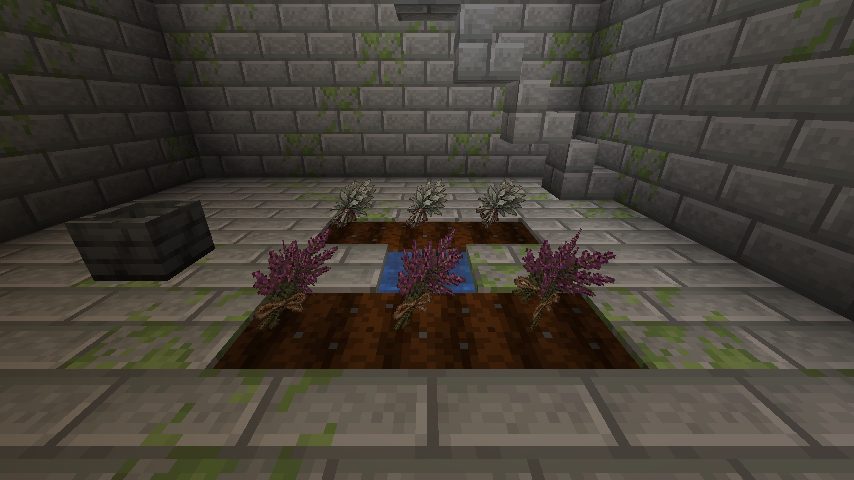

# 0.9.38 生存资源扩展验证记录

验证日期：2026-11-08（UTC）。版本、最后提交时间以 project-status.json 为准。本记录不把本地验证描述成 GitHub Actions 已通过。

## 已执行

| 项目 | 实际结果 |
|---|---|
| gradlew clean build runGameTestServer --offline --no-daemon | 完整构建成功；503 JUnit，0失败/0错误；39/39真实Forge GameTest |
| run_server_restart_matrix.py --timeout 240 | 修复版连续两次专服启动，世界种子/schema快照相同，保存并干净停服 |
| check_save_rollback.py | dry-run、精确恢复、安全备份、多余文件处理、路径穿越拒绝通过 |
| generate_survival_content.py --check | 102个生成JSON/NBT与清单一致 |
| check_resource_integrity.py | 601 JSON，2093双语键对，824静态引用，183模型；161物品/16方块/28实体 |
| check_visual_assets.py | 28实体渲染器、123图标、16方块模型、16粒子provider覆盖通过 |
| gen_pages_catalog.py --check / check_pages_layout.py | 330条图鉴，8加工配方、2遗迹；版本缓存与关键玩家入口一致 |
| 浏览器 | 1280宽桌面筛选/详情；390×844手机布局，正文无水平溢出，新分类图标有对比度，配方中文名称正确 |
| 客户端 | 一次性PM Visual QA 0.9.36旧测试存档正常加载；8研钵配方显示；修复后自然定位草药师遗址至(-432,304)，进入后观察药圃、水源、研钵、两箱与楼梯；保存退出并正常关闭 |
| GitHub编码审计 | 推送前19个Issue、68条评论无问号/替换字符乱码 |

## 实测发现与回归

1. 第一版遗迹测试漏算GameTest结构方块的Y+1模板偏移，箱子断言失败；按游戏实际结构坐标修正，未放宽箱子类型或掉落断言。
2. 更重要的是客户端自然定位暴露jigsaw size=0不产生根部件，导致完整范围搜索。Minecraft 1.20.1的实际生成实现只有深度大于0才将根部件加入输出；模板能加载不代表能自然生成。
3. 加入真实Structure.generate断言，对仍为0的资源复测，明确复现“real jigsaw generation must produce one root piece”失败；改为1后39项通过。客户端再次定位立即找到并实际进入自然遗址。
4. 旧失败定位客户端卡在搜索，曾只结束该一次性测试客户端进程；没有删除区块或正式存档。修复版重新打开同一个测试存档、保存与退出正常。
5. 浏览器发现原版原料ID不够友好、新分类图标缺少配色，补充中文名称和高对比图标，独立本地地址排除旧CSS缓存后复验。

## 负向验证不只检查文件存在

- 双手颠倒/不足量、无建造权限、超距、灵界活动冲突不扣原料；已拆研钵的旧状态不能加工。
- 满包真实生成产物与容器ItemEntity；不是删除产物后让测试只看输入扣减。
- 两玩家竞争成熟植株，第二次旧状态重放不发货；年龄6不可收、年龄7留根，骨粉实际增长。
- 石镐/木镐实际采掘判定；精准采集得到矿石；固定种子多次时运抽样有加成且不越界。
- 真实原版矿井表保留原版物品并追加恰好3银屑；120固定种子抽样中环境击杀无额外灰烬粉，合格玩家击杀不是全无或必出。
- 遗迹真实箱子延迟战利品与刷怪笼实体、开箱不二次补货；两种结构经真实生成器产生根部件。
- 8条配方网络序列化往返、输出副本隔离、计数0拒绝。

## 仍未验收

全量自然矿脉密度/长期经济平衡、所有地形的遗迹入口可达性、四人八小时连续游玩、工业/领地/性能/光影模组组合及全部未来v0.9内容未因此验收。本批没有新增独立生物群系或怪物实体。

