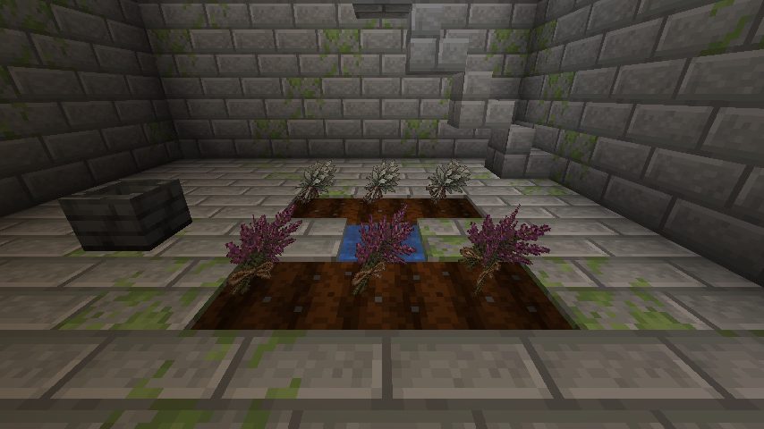

# M0–M5 视觉资源与验收

## 0.9.40 当前增量

新增6款物品贴图、夜枭/残影独立部件、8类粒子运动与减少动态/发光/环境开关。当前129独立图标、30实体渲染器、190模型、16粒子；[完整说明与边界](https://github.com/Herdeny/Lord-of-Mysteries/blob/main/docs/VISUAL_POLISH_0.9.40.md)。以下各版本是历史记录，历史计数不代表当前版本。

## 0.9.38 生存资源扩展

新增4种矿石、野生药草与作物生长模型、带实际空腔碰撞的研钵。矿石引用原版宿主材质，植物复用仓库原创药草PNG；没有声称新增原作官方素材。当前16个方块模型、183个物品/方块模型通过检查。

客户端实际定位并进入自然生成的草药师遗址，检查药圃、水源、研钵、宝箱与楼梯后保存退出。完整生成、掉落与交互回归见[生存资源循环](Survival-Resource-Loop)，39项Forge GameTest/503项JUnit不替代真人长测。

> 下方保留0.9.36的首次资产验收记录。0.9.37补充敌意/攻击姿态、350/1200/2200粒子寿命总量预算、生态研究反馈，以及桌面/390×844移动端图鉴实测；当前495项JUnit、31项GameTest与客户端交互/读档证据见[生态观察手册](https://github.com/Herdeny/Lord-of-Mysteries/blob/main/docs/SPIRIT_FIELD_RESEARCH.md)。基础模型并不代表最终高精美术与全套招式动画完成。

## 玩家能看到什么

本轮针对**已经注册并实现的内容**，不是把 v0.9 的所有未来途径和神话形态声明为已完成。
原著意象采用占卜/纸牌/灵体之线、门与星空、观众的精神幻象、猎人的火焰、偷盗者的暗影等视觉语言；
具体造型是同人原创设计，不声称每个自创生物外貌都是原著正典，也不使用官方插画、动画截图或提取模型。

| 范围 | 本轮交付 | 实现 |
|---|---|---|
| 非生成蛋物品 | 123 个独立 64×64 图标 | 材料、文书、工具、25 瓶魔药、24 件封印物 |
| 生成蛋 | 26 个标准染色蛋 | 保留 Forge 可辨认的生成蛋语义，不冒称原创图标 |
| 方块 | 7 个几何模型，16 个 64×64 材质 | 坩埚、祭坛、阵纹、捕兽夹、委托板、分离器、洗涤台 |
| 生物 | 27 个模型配置 / 10 类解剖结构 | 人形、蛇、水蛭、灵体、蛾、鸟、蜘蛛、藤蔓、面具、灯笼 |
| 旅行门 | 1 个专用实体渲染器 | 双面门框、透光内幕、门符粒子；通行权不变 |
| 粒子 | 16 类独立注册与精灵 | 同时保留原版火焰/声音等有明确语义的反馈 |

## 生物外观对应

- 疯言先知：靛蓝长衣、面具、礼帽与垂落触须；空手影：深色衣甲与异化末梢。
- 乱典魔像、誊写魔像：书页、黄铜领框与漂浮卷册；窥心魇：中央面具与侧面假面。
- 燃烬兽：炭化躯体、熔火胸腔；战蔷薇遗骸：荆棘材质与红色裂隙。
- 灰烬傀儡：木质身体、牵线横杆；幻形蛇/双头蛇：连续摆动蛇节，双头蛇额外一头。
- 窃能水蛭/记忆水蛭/裂隙幼体：贴地分节、不同材质与头部轮廓。
- 摇篮蛾：双翼、触角；灯蛾群：双翼与伴飞光团。低配不增加额外实体。
- 呓语鸦：羽翼、鸟喙、尾羽；罗盘鸟：额外黄铜冠和胸前罗盘。
- 档案蛛：八足与背负书页；秘偶藤：八条支撑藤与中央结核。
- 灵体微光、祈祷回响、食色者、门灵、煤气灯幽影：不同材质的悬浮核心和垂落末梢。
- 灵界摆渡人：兜帽、长桨、提灯；剧院面具灵：面具与飘带；墓园灯：金属框架与灵光核心。

模型使用 Forge/Minecraft 原生 ModelPart 分部几何，不新增 GeckoLib 运行依赖。
这与设计文档中 GeckoLib 方案存在实现差异，按“仓库现有实现优先”处理；**不是**49套完整 GeckoLib 神话形态或电影级动作。
具备移动、摆尾、振翅、触须和轻微悬浮动画；受伤/死亡方向使用引擎流程，人形保留手持物品层。
每个模型的分部数量由单元测试限制在40以内，共用256×256原创材质集。隐身实体不渲染发光层，避免视觉绕过隐身。

## 粒子与信息边界

| 精灵 | 接入范围 |
|---|---|
| spirit_wisp | 安抚反馈、灵界生态与灵界环境 |
| pollution_mote | 仪式失败、特性负载风险 |
| ritual_rune | 仪式完成与晋升结算 |
| divination_thread | 罗盘鸟方向意象 |
| dream_bubble | 精神能力、共享梦境环境与记忆生态 |
| ember_burst | 火焰跳跃、猎人/纵火家/收割者能力 |
| shadow_flicker | 暗影、无面控制、偷盗相关已有反馈 |
| page_glyph | 纸人替身、记录/知识类能力与档案生态 |
| grayfog_veil | 灰雾维度环境预留（仅存在该维度时生效） |
| characteristic_glow | 特性确认与灯蛾/墓园灯 |
| mirror_ripple | 幻象与面具生态 |
| petal_rose_shadow | 战蔷薇遗骸命中 |
| card_trace / air_ring | 纸牌命中 / 空气弹 |
| marionette_thread | 操纵丝线、秘偶控制与部分高级能力 |
| door_spark | 旅行门、空间转移与门灵 |

成功与失败仍以服务端消息、状态和既有判定为准。粒子不会自行造成伤害，不发送新的客户端操作包。
没有为原本隐秘、无视觉反馈的调查行为凭空添加暴露位置的公共提示。
不添加闪屏、相机震动或强制全屏遮挡。

客户端配置 `config/lord_of_mysteries-client.toml`：
`particleDensity = "LOW" | "STANDARD" | "RICH"`，每客户端每tick新增本模组粒子硬上限48/96/160。
切世界和退出会清空预算；还受 Minecraft 粒子设置约束。降级只减少展示，不取消伤害、警告文本、任务结算或导航数值。

## 来源与维护

- `docs/art-source/` 保存4张原始生成图集、完整提示词和123个物品的逐格对应。
- 使用内置 OpenAI image generation 制作原创像素图集。图像不是人工绘制或官方素材；模型几何和动画由项目代码定义。
- `python scripts/import_visual_atlases.py`（需要 Pillow）只执行网格切片、尺寸转换、留边、模型JSON生成与Pages图标复制，不下载其他素材。
- 运行时只读取已提交 PNG/JSON/Java，不依赖AI服务、Pillow、网络或额外资源包。
- 资产许可沿用 `ASSET_LICENSE.md` 的适用边界；原著名称与设定权利仍不属于本项目，本轮不更改授权状态。
- 不改变物品/实体ID、Capability schema30、网络协议13；客户端与服务器仍需使用匹配的模组版本。

## 验证入口

1. `python scripts/check_visual_assets.py`：注册表覆盖、非占位渲染器、PNG CRC/尺寸、工位边界、粒子provider和Pages字节一致性。
2. `./gradlew test`：图标非空/透明留边/互异、粒子轮廓、27模型与门的实际烘焙、40分部预算、密度限流、时间回退和退出清理。
3. `./gradlew clean build`、`runGameTestServer` 与服务器重启矩阵：资源打包和原有M0–M5行为回归。
4. `./gradlew runClient`：真实窗口、资源重载、创造/生存交互、生成全部实体与工位的检查。

### 一次性视觉测试场

**仅在新建的一次性创造世界运行** `/function lord_of_mysteries:dev/visual_gallery`。
它会覆盖主世界坐标x=-4..54、y=99..110、z=-4..42的测试区域（铺地板、清理遮挡物）并生成固定不动的展品，调整天气/时间和创造模式，不能用于正常存档。
测试场只用于检查模型，不代表生存模式战斗验收。按F3+T检查资源重载；对比LOW/STANDARD/RICH和最少粒子；使用隐身药水检查失控体发光层是否泄露。
正常游玩入口仍是 `/pm next`、调查板及M3/M4/M5的既有指引。

## 验收结果与边界

### 本轮实际客户端检查（2026-11-08）

- 新建隔离世界 `PM Visual QA 0.9.36`，进入单人游戏；初始手稿与罗盘正确发放并使用原创图标。
- 在测试场实际生成27种生物，观察模型全景；另行生成7个工位与旅行门，确认门框、光幕和门符精灵可见。
- 创造搜索栏检查灵性物品；右键新坩埚模型收到服务端配方/火候交互提示。
- F3+T资源重载后继续正常显示，并保存退出测试存档。截图见Pages“游戏内实拍”。
- 本机第一次启动在共享临时目录的 `lwjgl.dll` 出现0xc0000005；独立提取目录后进入游戏并正常退出。开发运行已固定使用 `run/client-natives`，未删除系统缓存、修改驱动或改动现有玩家存档。
- 实拍含Minecraft画面，第三方元素仍适用其原权利边界；不能把整张游戏截图都声明为本项目独占素材。

### 本轮机器验证（2026-11-08）

| 层级 | 实际结果 | 边界 |
| --- | --- | --- |
| 干净构建 | `clean build --offline --no-daemon` 成功，483项JUnit，0失败/0错误 | 包含7项新增视觉测试，不代表真人长测 |
| 原生模型与碰撞 | 27种模型和旅行门真实烘焙；5个工位体素与JSON几何一致；坩埚内部空腔/底部实体反向断言 | 不以“文件存在”代替模型烘焙 |
| 图片与性能预算 | 123种图标可见、互异、透明留边；粒子透明轮廓；48/96/160限流、时间回退与清理 | 不等同于所有显卡FPS实测 |
| Forge服务端 | 29/29必需GameTest通过 | 复用原有M0–M5行为测试，非27种生物逐一战斗测试 |
| 专服重启 | 串行启动两次，同一世界种子、schema30快照不变，两次正常保存退出 | 在客户端退出后运行，避免共享运行目录日志锁冲突 |
| Pages | 搜索“魔药”返回33条，实际显示独立瓶型图标；实拍折叠面板展示3张游戏截图 | 本轮浏览器实测桌面视口，移动端仍由响应式合同检查 |
| 发布资源门禁 | PNG完整性/尺寸、注册覆盖、图鉴与游戏PNG一致、图集来源哈希通过 | 美术内容最终审美与权利审核仍需人工 |

### 保留验收项

- 全部未来途径/高序列/神话形态、所有NPC独立模型、精确玩家伪装、专属音效音乐、完整招式骨骼动画。
- 任何光影/资源包/整合包都兼容，或所有显卡上帧率达标。
- 四人八小时、长存档、全部生存链路与平衡的真人验收。
- AI生成素材的所有细节都已达到最终美术品质；材质可按原ID继续替换。
